# Computer and Communication Networks: Transport 1

## UDP and principles of reliable data transfer

Lecture 4

---
layout: default
---

# Content overview

- Transport layer services
- Multiplexing and demultiplexing
- UDP
- Principles of reliable data transfer
- Reliable data transfer protocols (rdt1.0 to rdt3.0)
- Pipelined protocols
- Go-Back-N and Selective Repeat

---
layout: section
---

# Transport layer

IP gets a packet from one host to another, but promises nothing: packets can be lost, corrupted, delayed, duplicated, or arrive out of order. The transport layer is where we decide what to do about it, and where we finally say which application on the host the data is for.

---

# Transport layer: overview

IP delivers packets between hosts with no guarantees. Depending on the protocol, the transport layer can add what IP lacks:

<v-click>

- **Reliability**: all data delivered intact and in order (lost or damaged data is re-sent)
- **Flow control**: not overwhelming the receiver
- **Congestion control**: not overwhelming the network
</v-click>

---

# Transport services and protocols

The transport layer provides **logical communication** between application processes running on different hosts. Transport protocols run only in the end systems: routers forward using only the IP header.

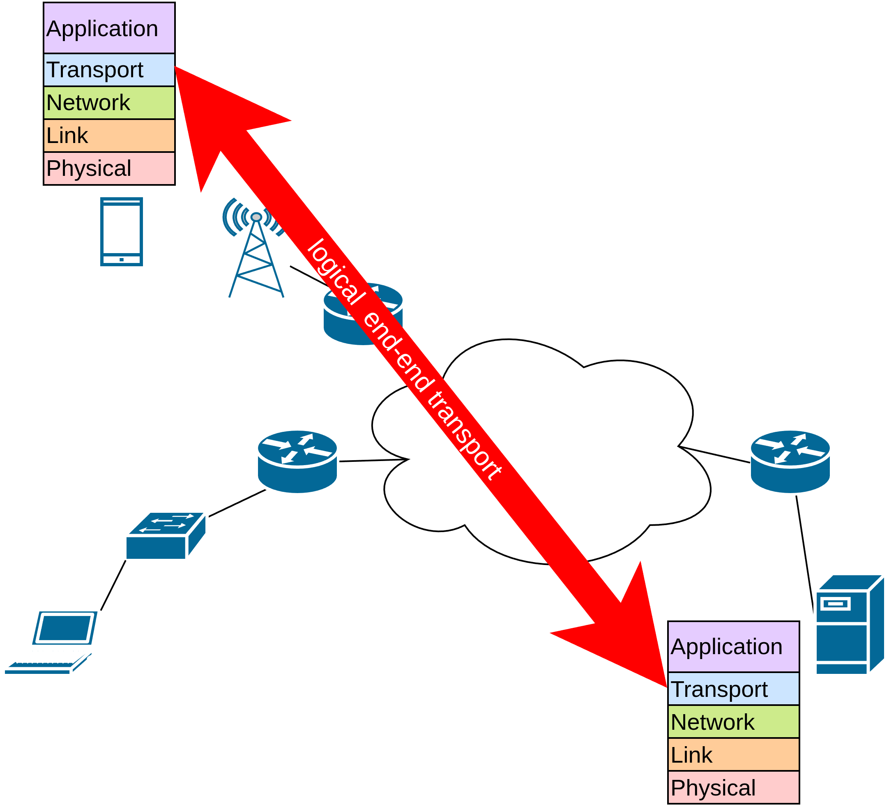

<v-click>

- **Sender** -> wraps application data into segments and passes them to the network layer (TCP may split a continuous stream of bytes into many segments, UDP sends each message as exactly one segment)
- **Receiver** -> extracts the data and delivers it to the right application (more precisely, to its socket, explained shortly)
- The Internet offers applications two transport protocols: **TCP** and **UDP**
</v-click>

---

# Transport vs. network layer

- **Network layer** -> communication between **hosts**, identified by IP addresses
- **Transport layer** -> communication between **processes**, more precisely their sockets, addressed by IP address and port
- The transport layer relies on the network layer's services and enhances them.
- It can add what IP lacks, such as reliable delivery over an unreliable network
- It cannot fix what IP doesn't control: delay and bandwidth guarantees stay out of reach

---

# Transport vs. network layer: an analogy

Two houses, each with 12 kids, exchange letters.

- Hosts = houses
- Processes = kids
- Application messages = letters
- Transport protocol = one person per house who collects outgoing letters and hands incoming ones to the right kid
- Network layer = the postal service between the houses

---

# Which process gets the data?

Back to the letter analogy: the postal service got the letter to the right house. Now the person inside has to figure out which kid it's for.

***How does your computer know this data belongs to Firefox, and not to Netflix or Telegram?***

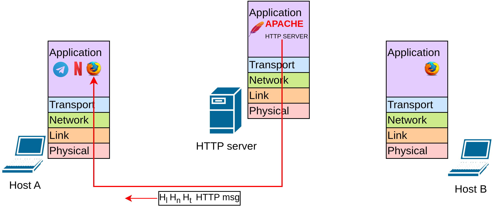

---

# Sockets: multiplexing and demultiplexing

The answer: Firefox, Netflix, and Telegram each talk to the network through their own **socket**, the door between a process and the network. The transport layer's job is to sort segments into the right socket.

- **Multiplexing** (sender) -> collect data from several sockets and wrap each piece in a transport header
- **Demultiplexing** (receiver) -> use the header to deliver each segment to the correct socket

<div class="flex justify-center gap-16 pt-4">
  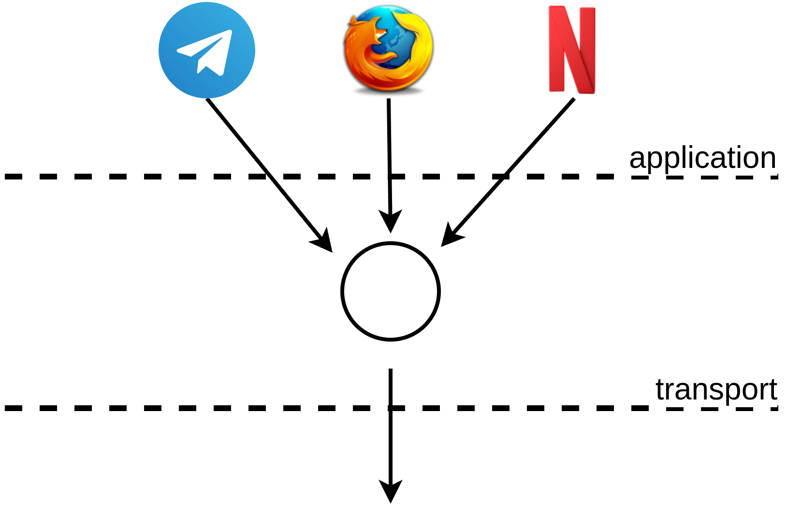
  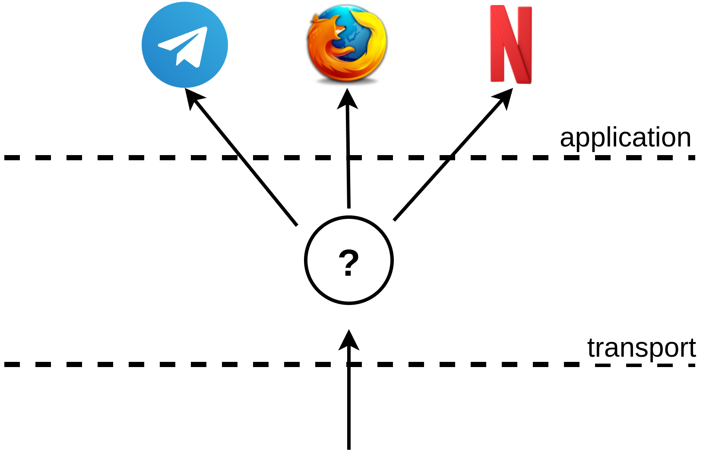
</div>

---

# How demultiplexing works

- The host receives IP packets, each with a source and a destination IP address
- Each packet carries one transport layer segment
- Each segment has a **source port** and a **destination port** (16 bits each), the first two fields of both the TCP and the UDP header
- The host uses the IP addresses and port numbers to direct the segment to the right socket

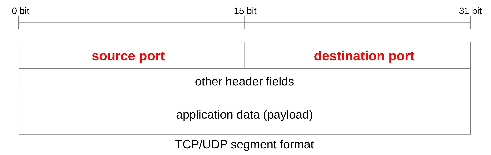

---

# Port numbers

A port is a 16-bit number, so it ranges from 0 to 65535. IANA divides the range into three parts:

| Range | Name | Used for |
|---|---|---|
| 0–1023 | Well-known | Standard services: 22 SSH, 53 DNS, 80 HTTP, 443 HTTPS |
| 1024–49151 | Registered | Specific applications, e.g. 3306 MySQL |
| 49152–65535 | Dynamic (ephemeral) | Picked by the OS for the client side of a conversation |

<v-click>

- A **server** listens on a fixed, known port, so clients know where to find it
- A **client** gets a temporary **ephemeral port** from the OS, it doesn't care which one

*Note: the ephemeral range depends on the OS, e.g. Linux uses 32768–60999 by default.*
</v-click>

---
layout: three-slots
---

# Demultiplexing: UDP vs. TCP

::left::

**UDP (connectionless)**
- Socket is identified by the destination IP address and the destination port
- Segments with the same destination port reach the same socket, even from different senders
- The server tells clients apart by the sender's address that comes with each segment

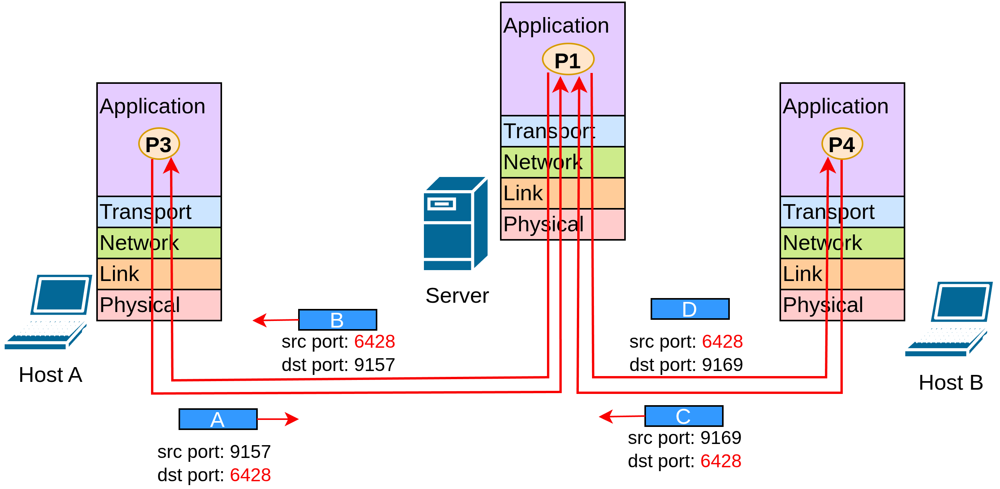

::right::

**TCP (connection-oriented)**
- Socket is identified by the 4-tuple: source IP, source port, destination IP, destination port
- Each **connection** gets its own socket, so one server port can serve many clients at once
- One process can own many sockets (P4, P5, P6 may just as well be threads of one web server)

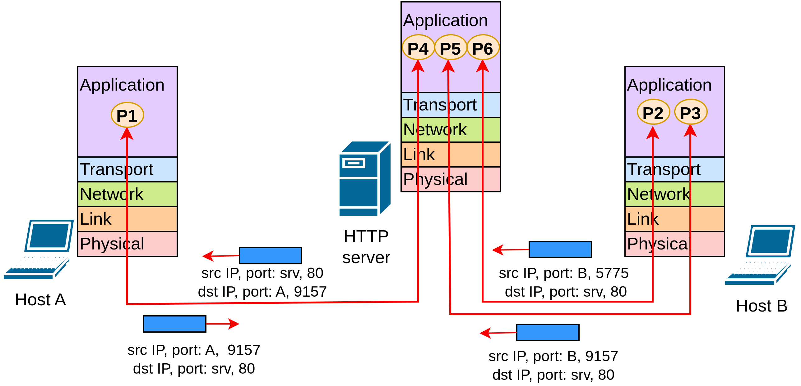

---
layout: section
---

# UDP

UDP is what you get when you add almost nothing to IP: ports, to say which application the data is for, and a checksum, to notice damaged data. Everything else is left to the application.

---

# UDP: no frills

**UDP** (User Datagram Protocol, RFC 768) is a bare-bones transport protocol.

<v-click>

- **Best effort**: segments may be lost or delivered to the application out of order
- **Connectionless**: no handshake, no connection state at the sender or the receiver, every segment handled independently
- **No congestion control**: UDP sends as fast as the application hands it data
</v-click>

*Note: names per layer: frame (link), packet (network), segment (transport). For UDP, the segment is often called a datagram, as in the protocol's name.*

---

# UDP: why does it exist?

If UDP gives so few guarantees, why use it?

<v-click>

- No connection setup, so no extra round trip before the first byte
- Simple: neither side keeps any connection state
- Small header: 8 bytes
- **Broadcast and multicast**: unlike TCP, UDP can be sent to a broadcast or multicast address (DHCP relies on this)
- No congestion control: the application alone decides how fast to send
</v-click>

---

# UDP segment header

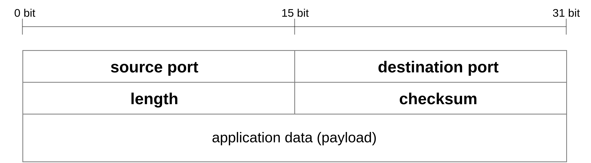

- **Source port** and **destination port**: the same fields we used for demultiplexing
- **Length** -> size of the UDP segment in bytes, header included
- **Checksum** -> lets the receiver detect errors in the segment

---

# UDP checksum

Goal: detect errors (flipped bits) in the transmitted segment.

<v-click>

**Sender:**
1. Set the checksum field to 0
2. Take a **pseudo-header** (source IP, destination IP, protocol = 17, UDP length), the UDP header, and the data, as a sequence of 16-bit words
3. Add them up, wrapping any carry out of the top bit back into the sum
4. Take the **one's complement** of the sum (flip every bit) and put it in the checksum field

The pseudo-header is never sent, both sides build it from the IP header. It lets the receiver detect a segment delivered to the wrong host or the wrong protocol.
</v-click>
<v-click>

**Receiver:** add up the same pseudo-header and the received segment, including the checksum field
- All bits are 1 -> no error detected, but undetected errors are still possible
- Otherwise -> error detected
</v-click>

---

# UDP checksum: an example

Two 16-bit words, added with wraparound:

```
   1110 0110 0110 0110
 + 1101 0101 0101 0101
 ---------------------
 1 1011 1011 1011 1011
   wraparound: + 1
   1011 1011 1011 1100   sum
   0100 0100 0100 0011   checksum (one's complement of the sum)
```

<v-click>

Receiver check: sum + checksum = 1111 1111 1111 1111 -> no error detected.
</v-click>
<v-click>

Weak protection: flip the last bit of the first word (0 -> 1) and the last bit of the second (1 -> 0), and the sum, and so the checksum, stays the same.
</v-click>

---

# Why a checksum if Ethernet already has FCS?

In the link layer lecture, reliable delivery was postponed to "the transport topic". Here is the first part of the answer.

<v-click>

- The Ethernet **FCS** is checked and recomputed on every link, so it cannot catch damage inside a router
- The transport checksum is computed by the sender and checked by the receiver, so it covers the whole path
- Not every link on the path is guaranteed to check for errors at all
</v-click>
<v-click>

This is the **end-to-end argument**: only the endpoints can verify that data arrived intact. Link-layer checks are useful, but they cannot replace an end-to-end check.
</v-click>

---

# UDP and fragmentation

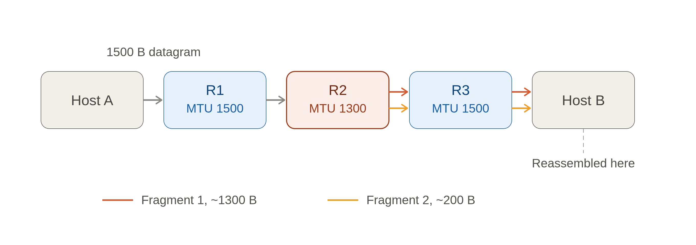

- UDP never splits a message: one `sendto` = one UDP datagram = one IP packet (before any fragmentation)
- If that packet doesn't fit the MTU, IPv4 fragments it, either at the sending host or at a router on the way, but only if DF = 0 (the flag from the IPv4 header). In IPv6, only the sender may fragment.
- Losing even one fragment drops the whole IP packet, and with it the UDP datagram. For UDP that is a serious problem: there is no retransmission to fall back on.

---

# Avoiding fragmentation

**Path MTU Discovery (PMTUD):**
- The sender sets DF = 1
- A router that cannot forward the packet drops it and reports back with ICMP "Fragmentation Needed" (IPv6: ICMPv6 "Packet Too Big")
- The dropped datagram is lost. The OS remembers the smaller path MTU, but UDP cannot split a message, so the application has to resend the data in smaller datagrams

<v-click>

**The simpler option:** keep UDP payloads at most about 1200 bytes.
- Not derived from a single formula, it's a safety margin: most real paths handle at least this, even with some extra overhead for tunnels or VPNs along the way
- QUIC assumes at least 1200 bytes, DNS recommends 1232
</v-click>

---

# UDP in code: sockets in Python

```python
from socket import *

# Sending
sock = socket(AF_INET, SOCK_DGRAM)   # SOCK_DGRAM = UDP
sock.sendto(data, (dest_ip, dest_port))

# Receiving
sock = socket(AF_INET, SOCK_DGRAM)
sock.bind((my_ip, my_port))          # claim a specific port
data, sender_addr = sock.recvfrom(2048)
```

- `sendto` names the destination every time, the OS picks the source port
- `bind` claims the port, so segments for it are demultiplexed to this socket
- Each `recvfrom` returns exactly one whole datagram (one `sendto`): UDP keeps **message boundaries**, unlike the TCP byte stream

---

# UDP: summary

- **No frills:** segments may be lost or arrive out of order, best effort only
- **Ports** identify the socket, and a **checksum** detects damaged segments
- **Plusses:** no setup and no extra round trip, no connection state, small header
- **Cost:** no reliability and no congestion control. Since a lost fragment loses the whole datagram, keep datagrams small enough to avoid fragmentation.
- **Building on top:** whatever more is needed is added above UDP, as QUIC (under HTTP/3) does


---
layout: section
---

# Reliability

---

# Principles of reliable data transfer

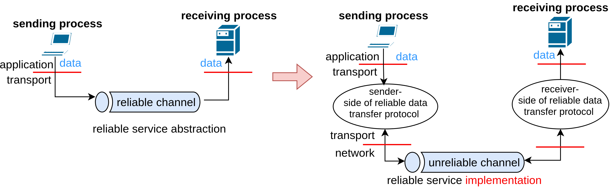

- **Abstraction** -> the application sees a reliable channel: what goes in on one side comes out on the other, complete and in order
- **Implementation** -> underneath there is only IP, an unreliable channel that may lose, corrupt, or reorder data
- A **reliable data transfer protocol** on both sides bridges the gap

<v-click>

- The more ways the channel can fail, the more complex the protocol has to be.
- The sender and receiver cannot see each other's state. The sender does not know whether a packet arrived unless the receiver tells it with a message.
</v-click>

---

# Defining reliability

What exactly should "reliable" mean? Three possible guarantees:

- **Best effort** -> what IP gives: packets may or may not arrive
- **At-least-once** -> every packet arrives, but some may arrive more than once
- **Exactly-once** -> every packet arrives, and exactly once
- On top of that, the data should reach the application **in order**

<v-click>

The plan: build at-least-once delivery on top of best-effort IP, then let the receiver throw away duplicates. The application then sees exactly-once delivery.
</v-click>
<v-click>

A reliable protocol may give up (for example, when the cable is unplugged), but it must tell the application. It must never claim that data was delivered when it was not.
</v-click>

---

# Dropped, delayed, and duplicated packets

From the best-effort list (lost, corrupted, delayed, duplicated, reordered), three problems shape the protocol most:

<v-click>

- **Dropped** -> the packet never arrives: a full router queue, or a frame discarded by a failed FCS check (link layer lecture). The sender must notice the silence and resend, so it needs a **timer**.
</v-click>
<v-click>

- **Delayed** -> the packet arrives, but late. If it arrives after the timer has expired, the sender has already sent it again, and the receiver gets it twice.
</v-click>
<v-click>

- **Duplicated** -> the receiver gets the same packet twice, usually because of a retransmission. Expected with at-least-once delivery. The receiver must recognize and discard the copy to give the application exactly-once.
</v-click>

---

# Reliable data transfer: interfaces

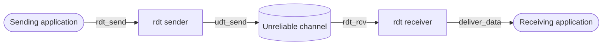

- **rdt_send()** -> called by the application to hand data to the sender side
- **udt_send()** -> called by rdt to push a packet into the unreliable channel
- **rdt_rcv()** -> called when a packet arrives from the channel, on either side (the sender receives ACKs this way)
- **deliver_data()** -> called by rdt to hand data up to the receiving application

---

# Reliable data transfer: getting started

We build the protocol step by step, each version handling one more problem of the channel.

- Data flows in one direction only, but control messages (like acknowledgments) flow both ways
- Sender and receiver are each described by a **finite state machine** (FSM)
- Assumption for rdt1.0 to rdt3.0: the channel may lose or corrupt packets, but never **reorders** them

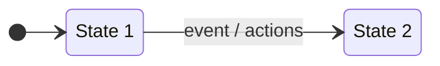

- **State** -> where the protocol is waiting. The current state and the next event together determine what happens next.
- **Transition** -> labelled "event / actions": what triggers it, and what the protocol does
- **Arrow from the black dot** -> the initial state
- In the labels, "data" means rdt_send() was called, "packet", "ACK", "NAK", or "corrupted" mean rdt_rcv() was called with such a packet, "send" means udt_send(), and "deliver" means deliver_data()

---
layout: three-slots
---

# rdt1.0: a perfectly reliable channel

Assumption: the underlying channel never flips bits and never loses packets. Nothing can go wrong, so there is nothing to fix. This is the baseline we build on.

::left::

**Sender**

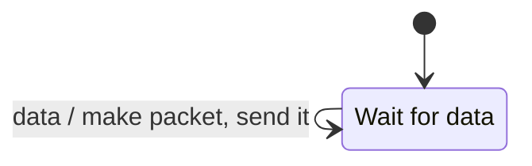

::right::

**Receiver**

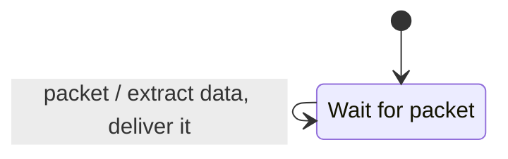

---

# rdt2.0: a channel with bit errors

New assumption: the channel may flip bits, but it does not lose packets. The checksum detects the error.

***How do people recover from errors in a conversation?***

<v-click>

- **ACK** (acknowledgment) -> the receiver tells the sender: packet arrived OK
- **NAK** (negative acknowledgment) -> the receiver tells the sender: packet had errors
- On a NAK, the sender **retransmits** the packet
</v-click>
<v-click>

**Stop-and-wait:** the sender sends one packet, then waits for the receiver's response before sending the next one.
</v-click>

---
layout: three-slots
---

# rdt2.0: FSM

- **No error:** the receiver delivers the packet and sends an ACK, the sender goes back to waiting for data
- **Error:** the receiver sends a NAK, the sender retransmits and keeps waiting

::left::

**Sender**

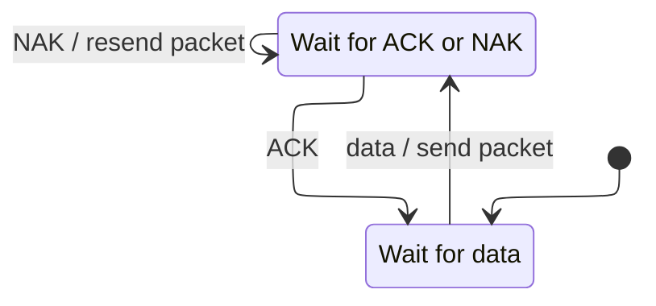

::right::

**Receiver**

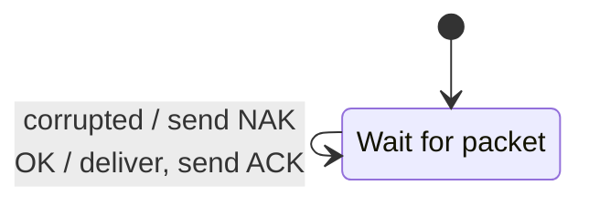

---

# rdt2.0: a fatal flaw

***What if the ACK or NAK itself gets corrupted?***

<v-click>

- The sender doesn't know what happened at the receiver
- It can't just retransmit: if the receiver already got the packet, it would receive a **duplicate** and deliver it twice
</v-click>
<v-click>

**Fix:**
- The sender adds a **sequence number** to each packet
- If the ACK/NAK is corrupted, the sender simply retransmits
- The receiver recognizes the duplicate by its sequence number and discards it
</v-click>

---

# rdt2.1: sender

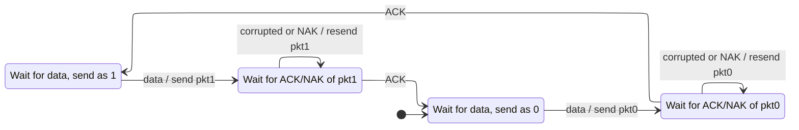

- Each packet carries sequence number 0 or 1, alternating
- Twice as many states: the sender has to remember whether the current packet is 0 or 1
- A corrupted ACK/NAK is treated the same as a NAK: retransmit

---

# rdt2.1: receiver

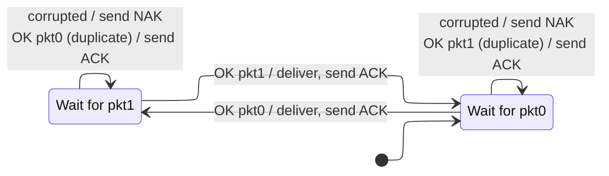

- The receiver's state says which sequence number it expects next
- A packet with the other sequence number is a duplicate: ACK it again, but don't deliver it. The sender evidently missed the last ACK and would otherwise keep retransmitting.
- The receiver never knows whether its last ACK/NAK arrived correctly

<v-click>

Two sequence numbers (0 and 1) are enough: with stop-and-wait, the receiver only has to tell the new packet from a retransmission of the previous one.
</v-click>

---
layout: three-slots
---

# rdt2.2: a NAK-free protocol

Same functionality as rdt2.1, using ACKs only.

- Instead of a NAK, the receiver ACKs the last packet it received correctly
- The ACK carries the **sequence number** of the packet it acknowledges
- A duplicate ACK at the sender means the same as a NAK: retransmit the current packet

*Note: TCP also has no NAKs, it signals problems with duplicate ACKs (details later).*

::left::

**Sender (part)**

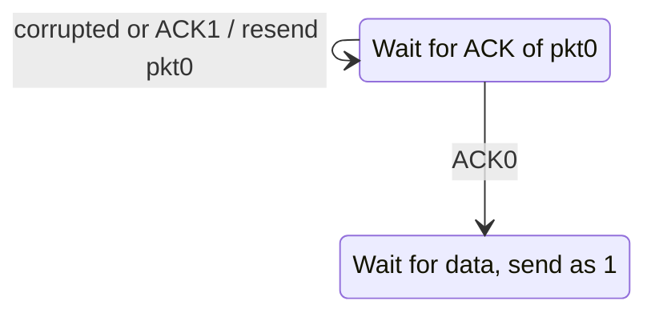

::right::

**Receiver (part)**

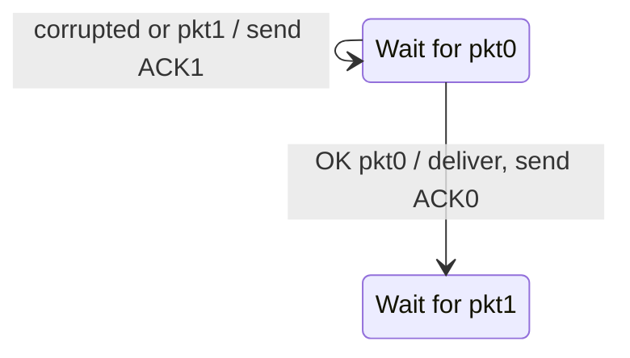

---

# rdt3.0: a channel with errors and loss

New assumption: the channel can also **lose** packets, both data and ACKs. Checksum, sequence numbers, ACKs, and retransmissions help, but they are not enough: a lost packet produces no response at all.

***Remember the dropped packets: what does the sender need now?***

<v-click>

- A countdown **timer**: if no ACK arrives in time, the sender retransmits
- If the packet or ACK was only delayed, not lost, the retransmission creates a duplicate. Sequence numbers already handle that.
- As in rdt2.2, the ACK carries the sequence number of the packet it acknowledges
</v-click>
<v-click>

**How long should the timer be?**
- Too short -> unnecessary retransmissions
- Too long -> slow recovery
- Slightly longer than one RTT. The RTT varies, so TCP measures it and adds a margin (later lecture).
</v-click>

---

# rdt3.0: sender

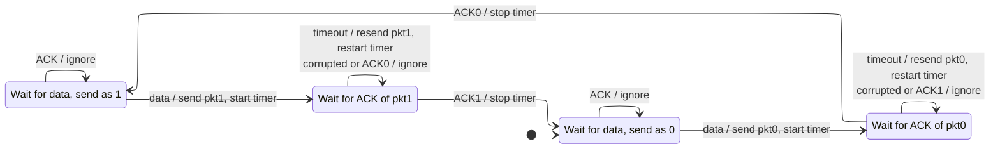

- **Start timer** every time a packet is sent
- **Timeout** -> retransmit the current packet and restart the timer
- **Stop timer** when the correct ACK arrives
- A corrupted or wrong ACK is ignored, unlike in rdt2.2: it may be a late ACK after a premature timeout, and retransmitting on it would only create more duplicates. The timer handles real losses.
- The receiver is the same as in rdt2.2

---
layout: three-slots
---

# rdt3.0 in action: packet loss

::left::

**(a) No loss**

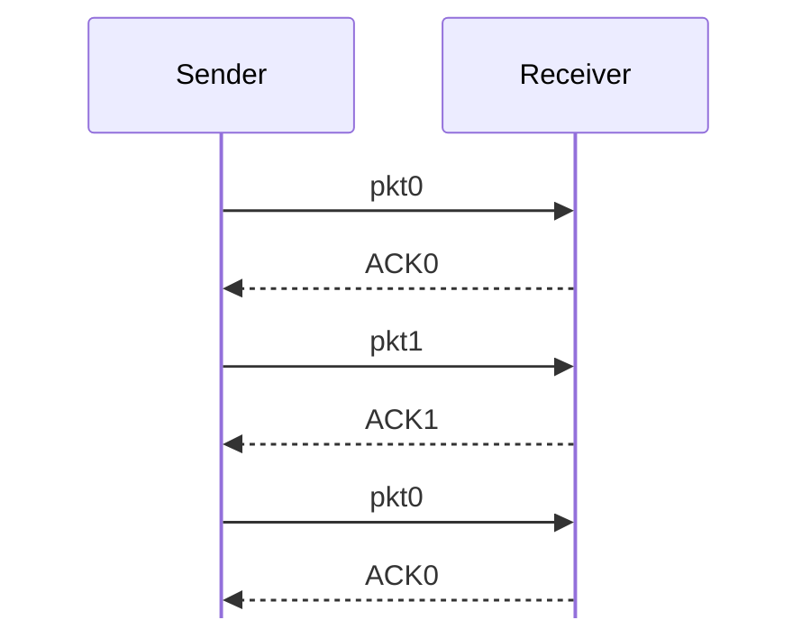

::right::

**(b) Packet loss**

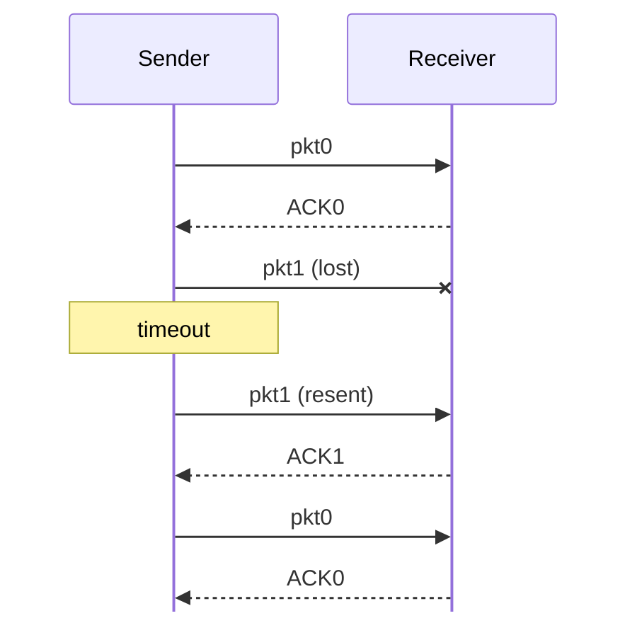

---
layout: three-slots
---

# rdt3.0 in action: ACK loss and premature timeout

::left::

**\(c) ACK loss**

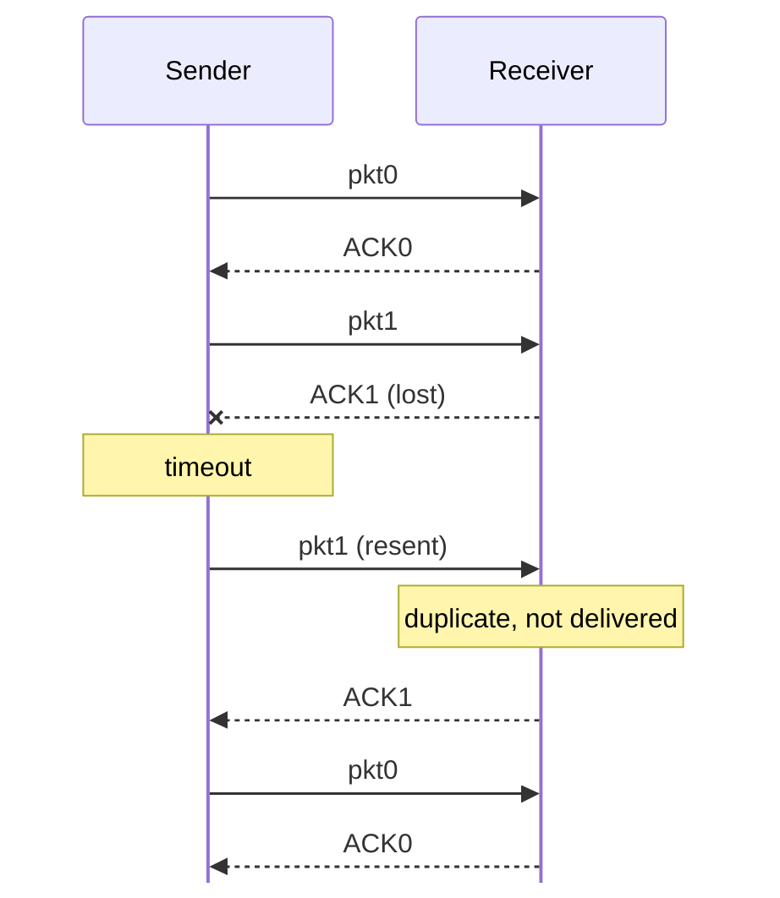

::right::

**(d) Premature timeout**

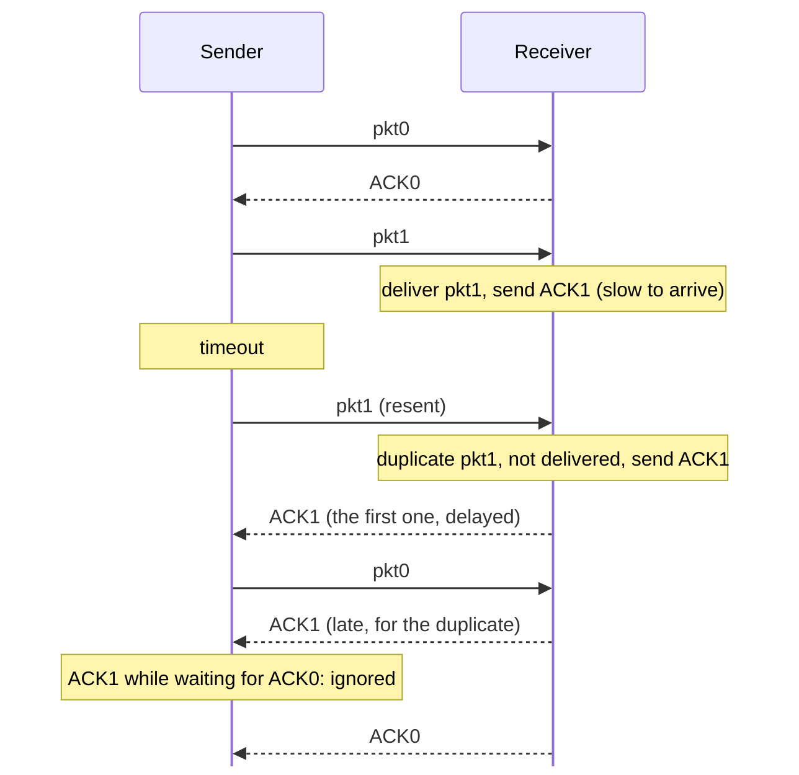

---
layout: section
---

# Pipelined protocols

The rdt3.0 protocol is correct: it survives bit errors, lost packets, and lost ACKs. But it is slow, because after every packet the sender sits idle for a whole round trip. The fix is to stop waiting and keep several packets on the way at once.

---
layout: three-slots
---

# Stop-and-wait: performance

Example: 1 Gbps link, 15 ms propagation delay, 8000-bit packet.

::left::

- **Transmission delay** (from the link layer lecture): d<sub>trans</sub> = L / R = 8000 b / 10<sup>9</sup> b/s = 8 µs
- **RTT** = 2 × 15 ms = 30 ms (processing, queueing, and the tiny ACK ignored)
- The next packet can leave only at t = RTT + L / R = 30.008 ms.

<v-click>

- **Sender utilization** -> fraction of time the sender is actually sending

$$
U_{sender} = \frac{L / R}{RTT + L / R} = \frac{0.008}{30.008} \approx 0.00027
$$
</v-click>

::right::

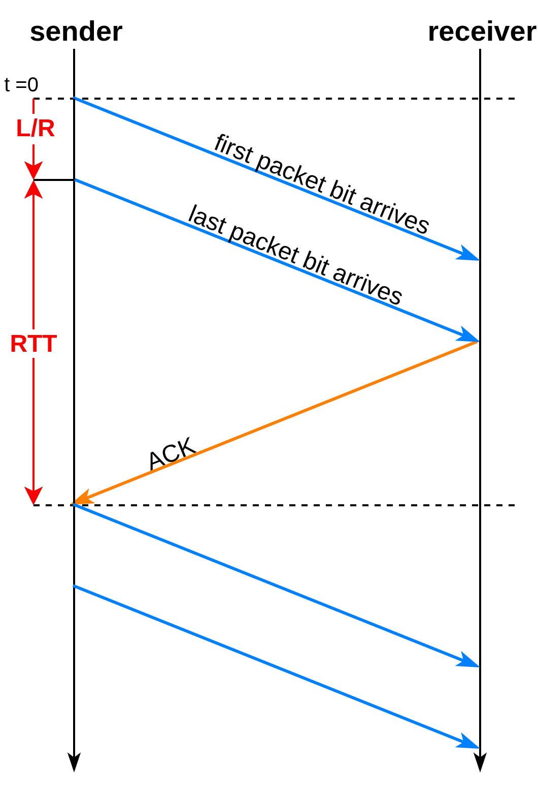

---

# Stop-and-wait: an almost empty pipe

- Effective throughput: 8000 bits every 30.008 ms ≈ 267 kb/s, on a 1 Gbps link
- The sender is busy 0.027 % of the time and waits for the rest.

<v-click>

Recall the **bandwidth-delay product** from the link layer lecture: the pipe volume is the number of bits that can be in flight at once.

- This link holds 10<sup>9</sup> b/s × 15 ms = 15 Mb in one direction.
- Stop-and-wait puts a single 8000-bit packet into it, about 0.05 % of the pipe.
</v-click>
<v-click>

The protocol, not the link, limits the performance: a faster link would barely help, because the time is spent waiting for the ACK.
</v-click>

---
layout: three-slots
---

# Pipelining: more packets in flight

::left::

- **Pipelining** -> the sender sends several packets without waiting for their ACKs
- **In flight** -> a packet that has been sent but not yet acknowledged
- Consequences: more sequence numbers than just 0 and 1, and buffers at the sender (for possible retransmission) and possibly at the receiver

With 3 packets in flight:

$$
U_{sender} = \frac{3L / R}{RTT + L / R} = \frac{0.024}{30.008} \approx 0.0008
$$

Three times better.

::right::

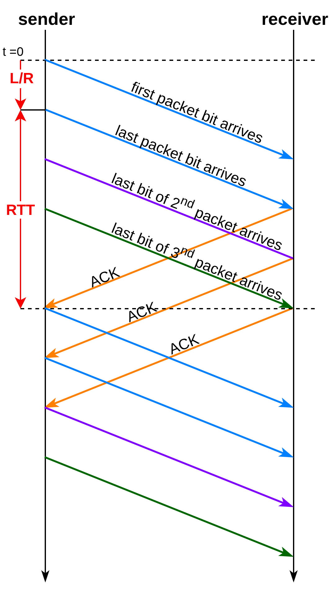

---
layout: three-slots
---

# Window-based protocols

::left::

***Why not send all packets at once?***

<v-click>

- Bandwidth is limited at the sender, at every router, and at the receiver.
- Queues would overflow and packets would be dropped, as in the link layer lecture.
</v-click>
<v-click>

- **Window** (W) -> maximum number of packets in flight at any time
  - Start: send W packets
  - Each ACK frees one slot: send the next packet.
- The window is not needed for correctness, only for performance.
</v-click>

::right::

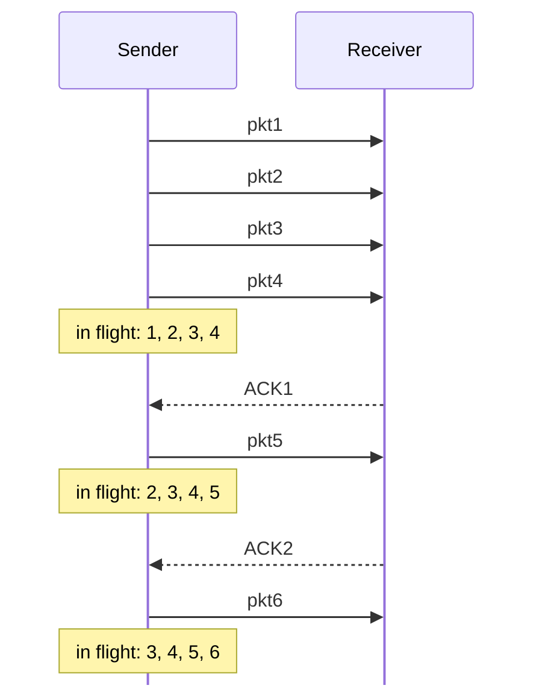

---

# Setting the window size

How big should W be? It has to balance three goals:

<v-click>

- **Fill the pipe**: use the capacity the network offers
- **Don't overload the receiver**: this is **flow control**
- **Don't overload the network**: this is **congestion control**
</v-click>
<v-click>

Flow and congestion control are TCP topics for the next lectures. Today we answer only the first question: how large must the window be to fill the pipe?
</v-click>

---

# Filling the pipe: how many packets?

The sender should never sit idle. The first ACK comes back only after about one RTT, so the window must allow sending for a whole RTT.

<v-click>

Example: RTT = 5 s, the path carries 10 packets per second.
- In the first 5 s no ACK arrives.
- In 5 s the sender can send 5 s × 10 packets/s = 50 packets.
- W = 50 keeps the sender busy. With W < 50, it runs out of window and has to wait.
</v-click>
<v-click>

**W ≈ bandwidth × RTT**
</v-click>
<v-click>

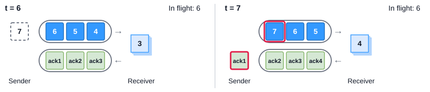

With W = 6, ack(1) arrives right when the window is full, just in time to send packet 7, so the sender never waits.
</v-click>

---

# Filling the pipe: the bottleneck

Which bandwidth? From "Latency and bandwidth" in the link layer lecture: end-to-end bandwidth is the **minimum** over all links on the path, set by the **bottleneck** link. Sending faster only fills the queue in front of it.

<v-click>

**Window (in bits) ≈ bottleneck bandwidth × RTT**

- It is the **bandwidth-delay product** from the link layer lecture, applied to the whole path and a full round trip: the data on its way to the receiver plus the time for the ACK to return.
- Example: links of 1 Gbps, 100 Mbps, 1 Gbps, RTT 40 ms: 100 Mb/s × 0.04 s = 4 Mb = 500 kB ≈ 333 packets of 1500 B
- Back to the stop-and-wait example: 1 Gb/s × 30 ms = 30 Mb ≈ 3750 packets of 8000 bits, while stop-and-wait sends 1
</v-click>
<v-click>

This is the window needed to fill the pipe; a larger window does not help. Flow control and congestion control may require a smaller one.
</v-click>

---
layout: section
---

# Go-Back-N and Selective Repeat

A window says how many packets may be in flight, but not what to do when one of them is lost. There are two classic answers: Go-Back-N resends the lost packet and everything after it, Selective Repeat resends only the lost packet.

---

# Go-Back-N: sender

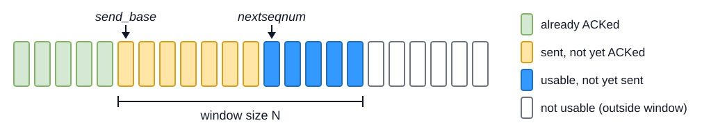

- **Sequence number** -> k bits in the packet header, so numbers 0 to 2<sup>k</sup> − 1, then wrap around
- **Window** -> up to N consecutive packets sent but not yet ACKed
- **send_base** -> oldest unACKed packet
- **nextseqnum** -> next packet to send

<v-click>

- **Cumulative ACK** -> ACK(n) acknowledges all packets up to and including n, the window slides to start at n + 1
- **Timer** -> only one, for the oldest packet in flight
- **Timeout** -> resend the oldest unACKed packet and every packet sent after it (all sent but unACKed), hence "go back N"
</v-click>

---

# Go-Back-N: receiver

- Always ACK the correctly received packet with the highest **in-order** sequence number
- **Out-of-order packet** -> discard it (or buffer it, an implementation choice) and re-ACK the highest in-order packet
- Re-ACKing the same packet produces **duplicate ACKs**.
- The receiver only has to remember **rcv_base**, the next sequence number it expects.

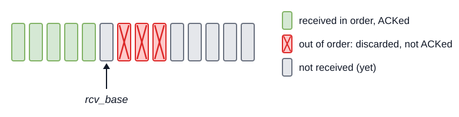

<v-click>

The receiver is very simple. The price: packets that arrived correctly but out of order are thrown away and sent again.
</v-click>

---
layout: three-slots
---

# Go-Back-N in action

::left::

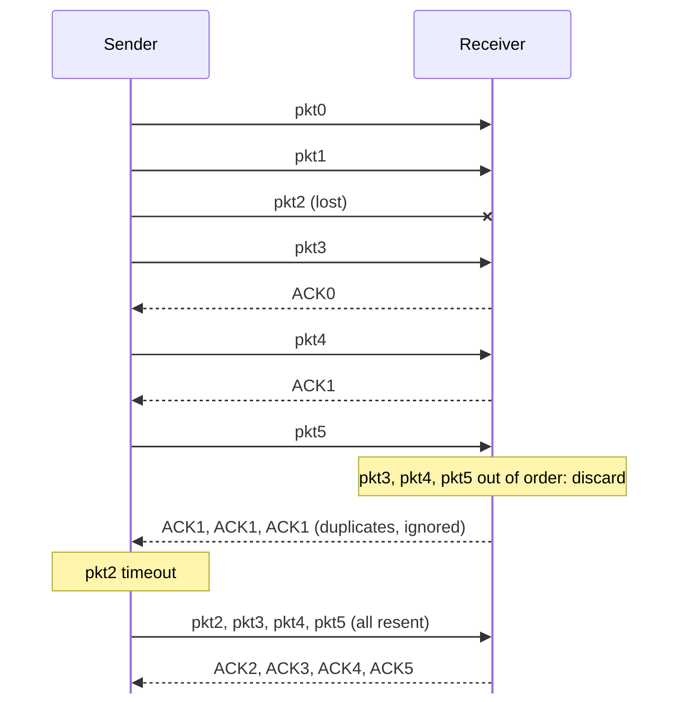

::right::

Window N = 4, pkt2 is lost.

- Window full after pkt0 to pkt3: the sender waits
- Each ACK slides the window by one and lets one new packet out (pkt4, pkt5).
- The receiver expects pkt2, so pkt3, pkt4, and pkt5 are discarded and answered with ACK1 again.
- The duplicate ACK1s carry no new information, so the sender ignores them.

<v-click>

- When the timer for pkt2 expires, the sender resends pkt2 and every packet after it.
- Packets 3, 4, and 5 travel twice, although they arrived fine the first time.
</v-click>

---

# Selective Repeat: the approach

Go-Back-N wastes bandwidth: one lost packet causes a whole window of retransmissions. **Selective Repeat** resends only what was really lost.

<v-click>

- The receiver ACKs every correctly received packet **individually**.
- It **buffers** out-of-order packets and delivers them to the application in order once the gap is filled.
- The sender keeps a **timer for each** unACKed packet (conceptually).
- On a timeout, the sender resends only that one packet.
- The sender window still limits packets in flight to N consecutive sequence numbers.
</v-click>

---

# Selective Repeat: sliding windows

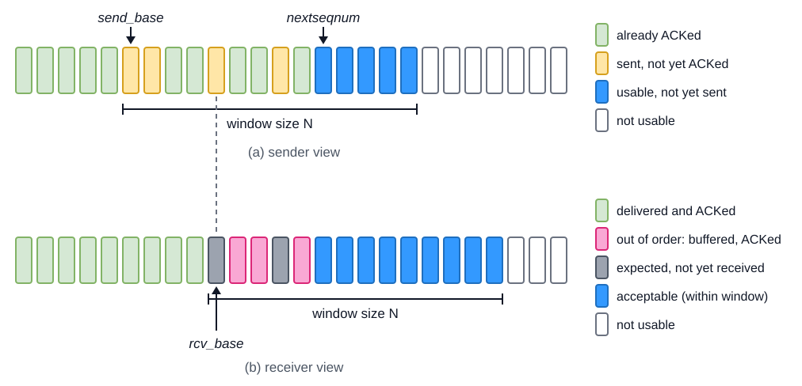

- Both sides have a window of size N, but the windows don't move together: each side sees only the packets and ACKs that reach it.
- The sender window may contain already ACKed packets, the receiver window may contain buffered ones.

---
layout: three-slots
---

# Selective Repeat: sender and receiver actions

::left::

**Sender**
- **Data from above** -> if the next sequence number is in the window, send the packet and start its timer
- **Timeout(n)** -> resend packet n and restart its timer
- **ACK(n) in the window** -> mark packet n as received. If n is send_base, slide the window to the next unACKed packet.

::right::

**Receiver**
- **Packet n in [rcv_base, rcv_base + N − 1]** -> send ACK(n). Out of order: buffer it. In order: deliver it together with the buffered packets that follow, and slide the window.
- **Packet n in [rcv_base − N, rcv_base − 1]** -> already delivered, but send ACK(n) again, since the earlier ACK may have been lost
- **Otherwise** -> ignore

---
layout: three-slots
---

# Selective Repeat in action

::left::

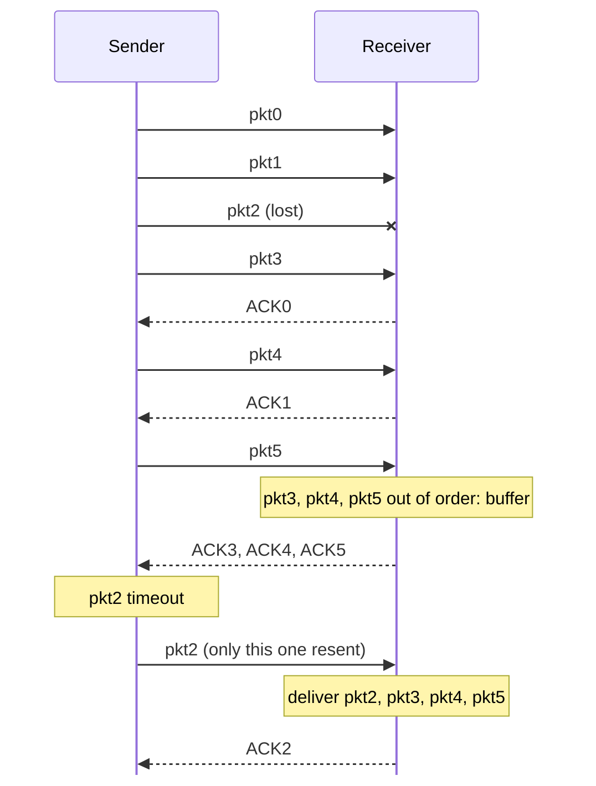

::right::

Window N = 4, pkt2 is lost, as before.

- The receiver buffers pkt3 to pkt5 and ACKs each one.
- The sender window is stuck at the missing pkt2.
- On the timeout, only pkt2 is resent.
- Once pkt2 arrives, pkt2 to pkt5 are delivered at once.

***What happens when ACK2 arrives?***

<v-click>

- The window jumps to start at 6, so pkt6 to pkt9 can go out at once.
</v-click>

---
layout: three-slots
---

# ACK strategies: individual vs. cumulative

- **Individual ACK** (Selective Repeat) -> ACK(n) means "packet n arrived". Precise, but a lost ACK causes a retransmission.
- **Cumulative ACK** (Go-Back-N) -> ACK(n) means "everything up to n arrived". A later ACK replaces a lost one, but the sender doesn't learn which packets after the gap arrived.

::left::

**Individual ACKs, ACK2 lost**

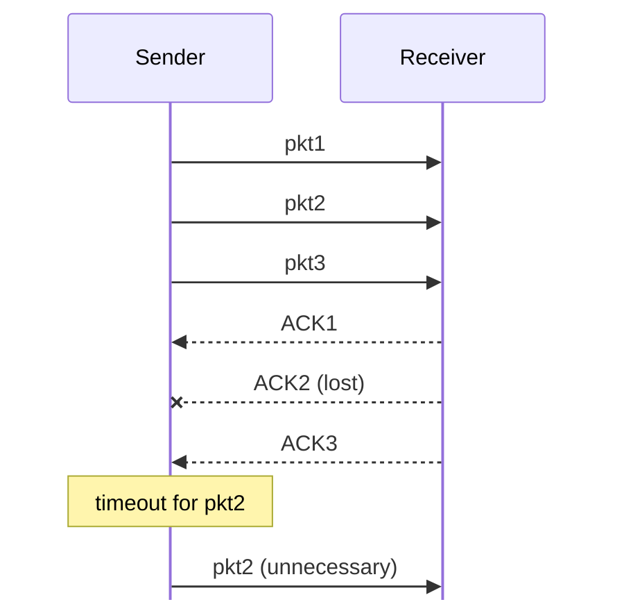

::right::

**Cumulative ACKs, ACK2 lost**

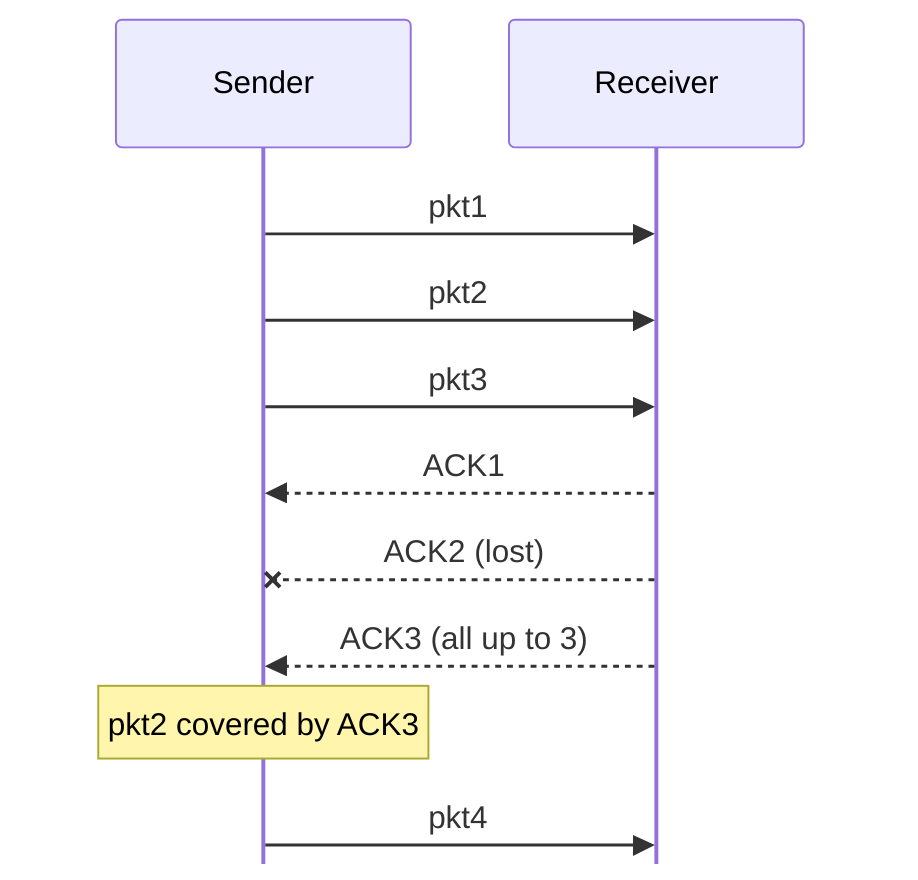

---
layout: three-slots
---

# Selective Repeat: a dilemma

::left::

Sequence numbers 0 to 3 (k = 2 bits), window N = 3.

- **(a)** ACKs arrive: the new pkt0 is accepted, correctly
- **(b)** ACKs are lost: the old pkt0 is resent and accepted as new data

<v-click>

The receiver sees the same packets in both cases and cannot tell them apart.
</v-click>
<v-click>

Fix: the receiver window must not overlap the old numbers the sender may still resend.
- **Selective Repeat** -> N ≤ 2<sup>k</sup> / 2
- **Go-Back-N** -> N ≤ 2<sup>k</sup> − 1 (its receiver accepts only one number)
</v-click>

::right::

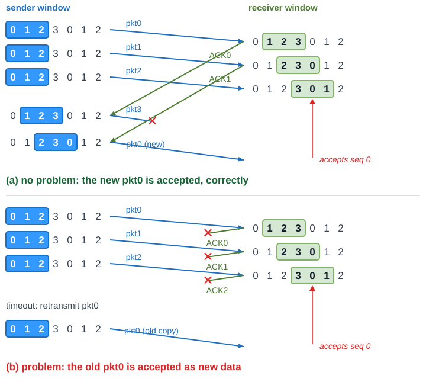

---

# Go-Back-N vs. Selective Repeat

<div class="text-sm">

| | Go-Back-N | Selective Repeat |
|---|---|---|
| ACKs | Cumulative | Individual |
| Timers | One, for the oldest unACKed packet | One per unACKed packet |
| On timeout | Resend the lost packet and all after it | Resend only the lost packet |
| Out-of-order packets | Discarded | Buffered |
| Receiver state | Only the next expected number | A window and a buffer |
| Max window (k-bit numbers) | 2<sup>k</sup> − 1 | 2<sup>k</sup> / 2 |
| Weak spot | Wastes bandwidth after a loss | More complex sender and receiver |

</div>

<v-click>

Real protocols mix both ideas. TCP uses cumulative ACKs like Go-Back-N, but buffers out-of-order segments and usually resends only the missing one, like Selective Repeat. More in the next lecture.
</v-click>

---

# References
1. KAO, Peyrin. CS 168 Textbook: Introduction to the Internet: Architecture and Protocols. [online]. University of California, Berkeley, 2024 [accessed 2026-10-12]. Available from: https://textbook.cs168.io/
2. KUROSE, James F. and ROSS, Keith W. Computer Networking: a Top Down Approach – authors' website. [online]. University of Massachusetts Amherst, 2025 [accessed 2026-10-12]. Available from: https://gaia.cs.umass.edu/kurose_ross/index.php
<br>

## License
This presentation incorporates material from two sources:
- Portions adapted from **[Peyrin Kao / UC Berkeley]**, licensed under [CC BY-SA 4.0](https://creativecommons.org/licenses/by-sa/4.0/).
- Some slides and figures adapted from **J.F. Kurose and K.W. Ross**,  *Computer Networking: A Top-Down Approach*. © 2010–2025 J.F. Kurose and K.W. Ross. All rights reserved. Used for educational purposes with attribution.

Text and formatting were refined with AI assistance; all technical content was reviewed and verified by the author.
